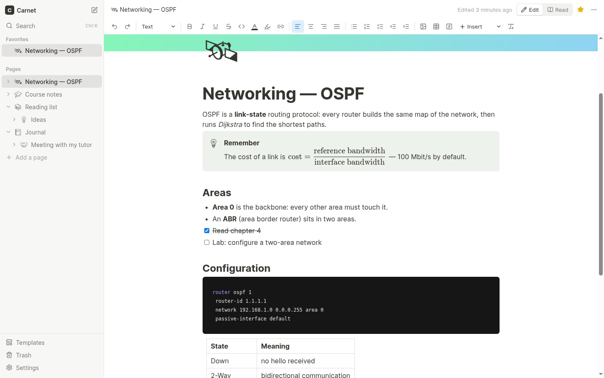

<div align="center">


# Carnet

**L'expérience Notion, sur votre propre serveur.**
Éditeur par blocs · pages imbriquées · bases de données (tableau, kanban, liste, galerie, calendrier) · barre d'outils façon Google Docs · mode lecture · import Obsidian et Notion · export Markdown · une API JSON.

[English](README.md)



</div>

## Pourquoi Carnet ?

Notion est agréable, mais vos notes sont chez quelqu'un d'autre. Obsidian garde vos fichiers, mais on lit du Markdown brut et on monte l'appli à coups de plugins. Joplin est privé, mais austère. Carnet prend le meilleur des trois :

- **De Notion, l'expérience** : tout est une page, une page contient des blocs et d'autres pages, sans limite. `/` pour insérer n'importe quel bloc, poignée pour glisser, colonnes par glisser-déposer. Des bases de données dont chaque ligne est une page, avec vues, filtres et tris.
- **De Google Docs, la barre d'outils** : une barre fixe en haut (type de bloc, gras, couleurs, surlignage, alignement, listes, retrait, tableaux, formules…) et un **mode Lecture** propre pour réviser ou imprimer en PDF.
- **D'Obsidian, la liberté** : mentions `@` et liens `[[ ]]` avec rétroliens, import d'un coffre complet en un clic (le front matter devient des propriétés de base de données), export de tout en fichiers Markdown qui s'ouvrent comme un coffre Obsidian.
- **De Joplin, la confidentialité** : auto-hébergé, un fichier SQLite et un dossier de pièces jointes à sauvegarder, mot de passe et jetons d'API, rien n'est envoyé ailleurs.

## Démarrage rapide

```bash
git clone https://github.com/mathyouadr/carnet.git && cd carnet
cp .env.example .env          # choisissez un mot de passe (CARNET_PASSWORD), CARNET_LANG=fr
docker compose up -d
```

Ouvrez **http://votre-serveur:8044**. Sans Docker : `(cd web && npm ci && npm run build)` puis `python3 -m carnet` (Python 3.10+, aucune dépendance côté serveur).

## Venir d'Obsidian, de Notion ou de Joplin

**Paramètres → Importer** accepte un `.zip` (ou un `.md`) : coffre Obsidian zippé, export Notion « Markdown & CSV », dossier de fichiers Markdown. En ligne de commande : `python3 -m carnet import ~/Obsidian/MonCoffre`.

Pour garder des fichiers `.md` là où ils sont : `CARNET_MD_FOLDERS=Coffre=/chemin/du/coffre` les affiche en **lecture seule** dans la barre latérale (sous-dossiers = sous-pages, liens `[[ ]]`, rétroliens, recherche). Les fichiers restent la référence.

Pour partir : **Paramètres → Tout exporter** donne un zip de fichiers Markdown (sous-pages en dossiers, pièces jointes dans `_files/`).

## Partager une page sur le web

**⋯ → Partager sur le web** donne un lien secret (`/s/<jeton>`) qui montre la page et ses sous-pages **en lecture seule** à qui l'a, sans connexion. Couper le lien le désactive tout de suite. Avec `CARNET_SHARE_PORT=8045` (et `CARNET_SHARE_URL`), ce port ne répond **qu'aux** pages partagées : un tunnel Cloudflare ou un reverse proxy peut le publier sans exposer le reste de vos notes.

## API

Les pages acceptent et renvoient du **Markdown** : voir [docs/api.md](docs/api.md).

```bash
curl -H "Authorization: Bearer $TOKEN" -H "Content-Type: application/json" \
     -d '{"title":"OSPF","props":{"Matière":"SISR","Révisé":false}}' http://localhost:8044/api/databases/<id>/rows
```

## Raccourcis

`/` blocs · `@` mentionner une page · `Ctrl+K` rechercher · `Ctrl+Alt+N` nouvelle page · `Ctrl+Maj+L` Édition / Lecture · `Ctrl+\` barre latérale.

## Licence

[AGPL-3.0-or-later](LICENSE).
