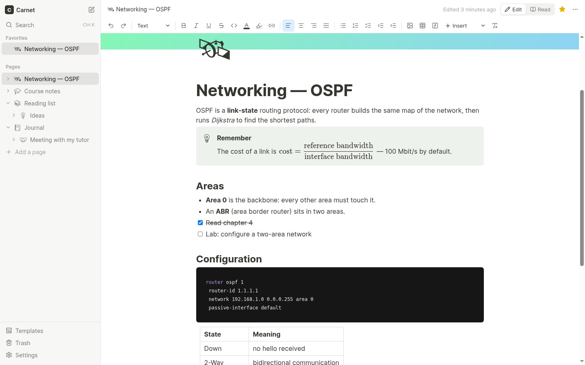
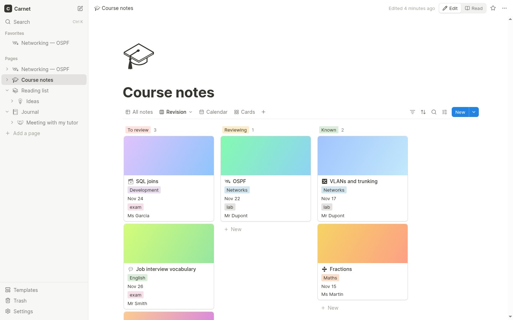
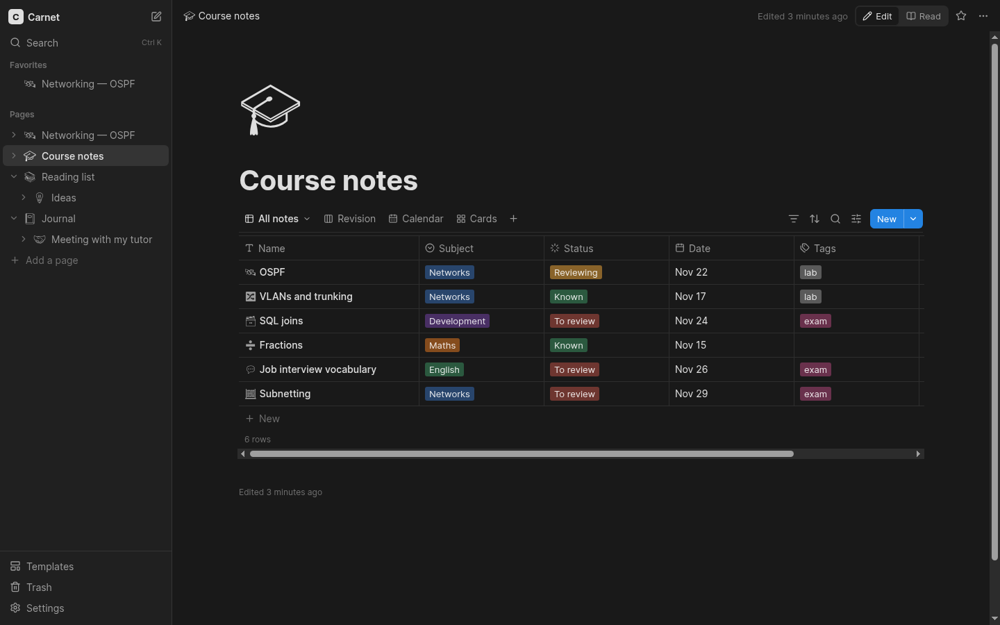
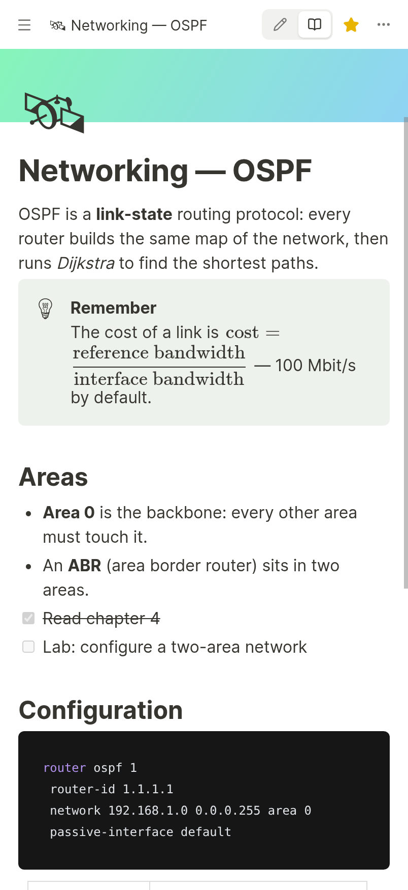
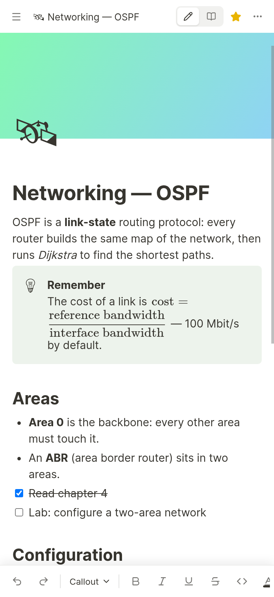
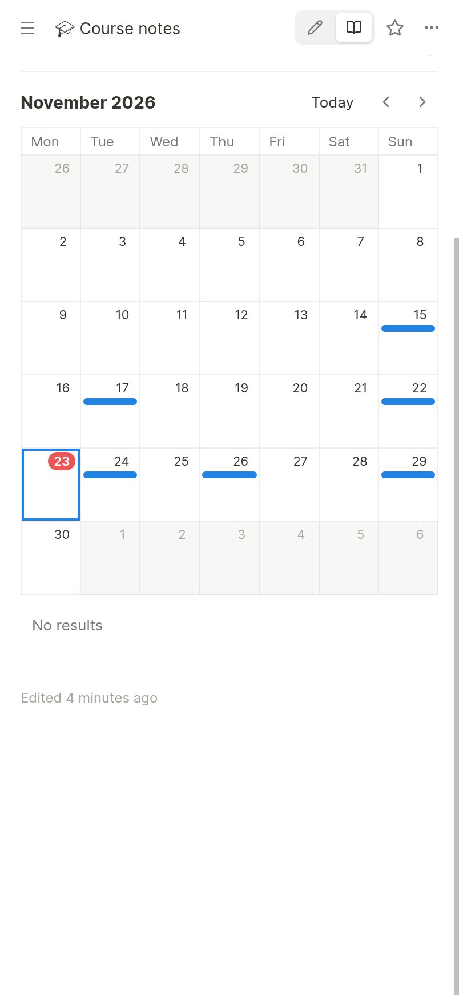

<div align="center">


# Carnet

**The Notion experience, on your own server.**
Block editor · nested pages · databases with table, board, list, gallery and calendar views · Google-Docs-style toolbar · reading mode · Obsidian & Notion import · Markdown export · a JSON API.

[Quick start](#-quick-start) · [Features](#-features) · [Import](#-coming-from-obsidian-notion-or-joplin) · [API](#-api) · [Configuration](#%EF%B8%8F-configuration) · [Français](README.fr.md)


[](https://github.com/mathyouadr/carnet/actions/workflows/ci.yml)



<table>
<tr>
<td></td>
<td></td>
</tr>
<tr align="center"><td>Databases: board, table, list, gallery, calendar</td><td>Dark theme</td></tr>
</table>

<table>
<tr>
<td></td>
<td></td>
<td></td>
</tr>
<tr align="center"><td>Read mode on a phone</td><td>Toolbar docked above the keyboard</td><td>Calendar view</td></tr>
</table>

</div>

---

## Why Carnet?

Notion is a joy to write in, but your notes live on someone else's servers. Obsidian keeps your files, but you stare at raw Markdown and assemble the app from plugins. Joplin is private and offline, but plain.

Carnet (French for *notebook*) takes the best of the three:

- **From Notion — the experience.** Everything is a page; pages hold blocks and other pages, without limit. Type `/` for any block, drag blocks by their handle, drop them beside each other for columns. Databases where every row is a page, with real views, filters and sorts.
- **From Google Docs — the toolbar.** A fixed formatting bar at the top (block type, bold, colors, highlight, alignment, lists, indent, tables, formulas…) and a clean **Read** mode for reviewing or printing to PDF.
- **From Obsidian — the freedom.** `[[wiki-style]]` and `@` page mentions with backlinks, one-click import of a whole vault (front matter becomes database properties), export everything back to Markdown files that open as an Obsidian vault.
- **From Joplin — the privacy.** Self-hosted, one SQLite file + an uploads folder to back up, a password and API tokens, nothing phones home.

## ✨ Features

**Writing**
- Notion-style block editor (based on [BlockNote](https://www.blocknotejs.org)): headings, lists, to-dos, toggles, quotes, callouts, code with syntax highlighting, tables, images, files, video, embeds (YouTube, Maps, Figma, PDFs…), dividers, **columns**, table of contents.
- Markdown shortcuts while typing (`# `, `- `, `[] `, `> `, ` ``` `) — the Markdown never stays raw.
- **Math**: LaTeX blocks and inline formulas rendered with KaTeX.
- `@` to mention a page (or create one), `/` for every block, sub-pages and inline databases from the same menu.
- Text and background colors, alignment, page icons (emoji picker), covers (gallery, upload or link), full width, small text, serif / mono fonts, lock page.
- **Edit / Read** switch per page (`Ctrl+Shift+L`); Read mode is the default on phones.

**Organising**
- Unlimited nesting, drag & drop in the sidebar (before / after / inside), favorites, move to…, duplicate (with everything inside).
- **Backlinks** at the bottom of each page.
- **Full-text search** (`Ctrl+K`), accent-insensitive, with highlighted snippets.
- **Templates**: turn any page into a template; database templates in the *New ▾* menu.
- **Page history**: a version every 10 minutes of editing, preview and restore.
- **Trash** with restore, emptied after 30 days.

**Databases**
- Properties: text, number (number, %, €, $), select, multi-select, status, date (with time and end date), checkbox, URL, email, phone, relation, created / edited time.
- Views: **table** (resizable columns), **board** (drag cards between columns), **list**, **gallery** (cover or content preview), **calendar** (drag events to another day).
- Filters (AND / OR), multi-level sorts, search, hidden properties, per-view settings; new rows inherit the active filters.
- Rows open in a **side peek** with their properties above the content, or as a full page.
- Inline databases inside any page; CSV export.

**AI assistant (optional)**
- Notion-AI style: select text and click **✨ Ask AI**, type `/ai`, or press Space on an empty line.
- Improve, fix spelling, shorten, lengthen, simplify, explain, translate, summarize, continue writing, or ask anything.
- The answer streams into a card under the text, with removed words struck through and added words in green. **Replace**, **Insert below**, **Retry** or **Discard**; nothing changes until you accept, and one `Ctrl+Z` undoes it.
- Works with any OpenAI-compatible endpoint (OpenAI, Ollama, OpenRouter, an agent such as Hermes Agent's API server). See [AI assistant](#-ai-assistant).

**Everywhere**
- Responsive down to 320 px: drawer sidebar, toolbar docked above the keyboard, bottom sheets, a calendar that becomes a day list.
- Light and dark themes, English and French.
- Installable as an app (PWA manifest), works under a sub-path behind a reverse proxy.

## 🚀 Quick start

### With Docker (recommended)

```bash
git clone https://github.com/mathyouadr/carnet.git && cd carnet
cp .env.example .env          # pick a password (CARNET_PASSWORD)
docker compose up -d
```

Open **http://your-server:8044**, sign in, and start writing. A welcome page and an example database show you around.

One-liner without Compose:

```bash
docker run -d --name carnet -p 8044:8044 -v carnet-data:/data -e CARNET_PASSWORD=your-password ghcr.io/mathyouadr/carnet:latest
```

### Without Docker

The server needs only Python 3.10+ (standard library + SQLite). The web app is built once with Node 20+:

```bash
git clone https://github.com/mathyouadr/carnet.git && cd carnet
(cd web && npm ci && npm run build)        # writes carnet/static/
CARNET_PASSWORD=your-password python3 -m carnet
```

To keep it running, see [`deploy/carnet.service`](deploy/carnet.service) (systemd) and [`deploy/nginx.conf`](deploy/nginx.conf) (HTTPS reverse proxy).

## 📥 Coming from Obsidian, Notion or Joplin

**Settings → Import** takes a `.zip` (or a single `.md`):

| From | What to upload | What you get |
|---|---|---|
| **Obsidian** | a zip of your vault folder | folders → pages with sub-pages, `[[links]]` and `![[embeds]]` resolved, attachments uploaded, callouts, math, front matter kept; a folder whose notes share front matter becomes a **database** (types are guessed: dates, checkboxes, numbers, selects, tags) |
| **Notion** | *Export → Markdown & CSV* zip | pages and sub-pages, Notion's id suffixes removed from titles |
| **Joplin / any Markdown** | a zip of `.md` files | one page per file, folders as parent pages |

From the command line (large vaults):

```bash
python3 -m carnet import ~/Obsidian/MyVault           # or a .zip, or one .md file
docker compose run --rm -v ~/Obsidian/MyVault:/import:ro carnet import /import
```

**Or keep your files where they are:** `CARNET_MD_FOLDERS=Vault=/path/to/vault` shows a folder of Markdown files in the sidebar, read-only, as pages: sub-folders become sub-pages, a folder note becomes the folder page, `[[links]]` resolve like in Obsidian, and backlinks and search include them. The files stay the source of truth, so you can keep editing them with Obsidian, a script or an AI agent. Changes appear within seconds. Icons come from `icon:` in the front matter or a `.carnet-icons.json` at the folder root (`{"icons": {"path/without/.md": "🖥️"}}`). Writing to these pages through the app or the API is refused (403).

**Leaving is just as easy:** *Settings → Export everything* downloads a zip of Markdown files (sub-pages in folders, attachments in `_files/`) that opens directly as an Obsidian vault. Any page: *⋯ → Export as Markdown / PDF*; any database: *view menu → Export as CSV*.

## 🔌 API

Everything the app does goes through a small JSON API, so scripts (and AI assistants) can read and write your notes. Pages accept **Markdown** in and out.

```bash
TOKEN=...   # CARNET_TOKENS in .env
# create a page from Markdown
curl -H "Authorization: Bearer $TOKEN" -H "Content-Type: application/json" \
     -d '{"title":"Meeting","markdown":"# Notes\n\n- [ ] send the slides"}' http://localhost:8044/api/pages
# read it back as Markdown
curl -H "Authorization: Bearer $TOKEN" "http://localhost:8044/api/pages/<id>?format=markdown"
# add a row to a database, properties by name; unknown select values become new options
curl -H "Authorization: Bearer $TOKEN" -H "Content-Type: application/json" \
     -d '{"title":"OSPF","props":{"Subject":"Networks","Done":false,"Date":"2026-11-24"}}' \
     http://localhost:8044/api/databases/<db-id>/rows
# filter rows, search
curl -H "Authorization: Bearer $TOKEN" "http://localhost:8044/api/databases/<db-id>/rows?Subject=Networks"
curl -H "Authorization: Bearer $TOKEN" "http://localhost:8044/api/search?q=ospf"
```

Full list of endpoints: [docs/api.md](docs/api.md).

## ⚙️ Configuration

Environment variables (or a `.env` file next to where you start it):

| Variable | Default | Meaning |
|---|---|---|
| `CARNET_PASSWORD` | *(none)* | Web login. Without it, use Carnet only on a trusted network. |
| `CARNET_TOKENS` | | Comma-separated API tokens (`Authorization: Bearer …`). |
| `CARNET_HOST` / `CARNET_PORT` | `127.0.0.1` / `8044` | Listen address (`0.0.0.0` in Docker). |
| `CARNET_DATA_DIR` | `~/.local/share/carnet` | `carnet.db` + `files/` — the two things to back up. |
| `CARNET_BASE_PATH` | | Serve under a sub-path (`/notes`) behind a proxy. |
| `CARNET_LANG` | browser | `en` or `fr`. |
| `CARNET_TITLE` | `Carnet` | Workspace name. |
| `CARNET_THEME` | user choice | Force `light` or `dark`. |
| `CARNET_ALLOWED_HOSTS` | | Host names accepted without a password (anti DNS-rebinding). |
| `CARNET_SECURE_COOKIE` / `CARNET_TRUST_PROXY` | off | Behind HTTPS / a reverse proxy. |
| `CARNET_MAX_UPLOAD_MB` | `50` | Largest upload. |
| `CARNET_MD_FOLDERS` | | Markdown folders shown **read-only** next to your pages: `Name=/path;Other=/path`. |
| `CARNET_AI_URL` | | OpenAI-compatible base URL (`…/v1`) for the AI assistant. Empty = no AI anywhere in the UI. |
| `CARNET_AI_KEY` / `CARNET_AI_MODEL` | / `hermes-agent` | Bearer key (stays on the server) and model name sent to that endpoint. |
| `CARNET_AI_NAME` / `CARNET_AI_SYSTEM` / `CARNET_AI_TIMEOUT` | `AI` / / `120` | Name shown in the UI, extra system prompt (`@/path` reads a file), seconds. |
| `CARNET_EXTRA_HEAD` / `CARNET_EXTRA_BODY` | | HTML injected in the page (`@/path/file.html` reads a file) — e.g. to re-theme Carnet with its CSS variables (`--cn-bg`, `--cn-fg`, `--cn-accent`…). |

## ✨ AI assistant

Set `CARNET_AI_URL` to any OpenAI-compatible `chat/completions` endpoint and the editor gets an *Ask AI* menu. The browser only talks to Carnet: Carnet adds the key, calls the endpoint and streams the answer back, so the URL and the key never reach the page.

> [!WARNING]
> The selected text, the surrounding part of the page and, for free requests, short excerpts of related notes are **sent to that endpoint**. Use a local model or a provider you trust with your notes.

```bash
# OpenAI
CARNET_AI_URL=https://api.openai.com/v1 CARNET_AI_KEY=sk-... CARNET_AI_MODEL=gpt-4.1-mini
# Ollama on the same machine
CARNET_AI_URL=http://127.0.0.1:11434/v1 CARNET_AI_MODEL=llama3.1
# Hermes Agent (API server): the assistant then knows you (memory, profile)
CARNET_AI_URL=http://127.0.0.1:8642/v1 CARNET_AI_KEY=<API_SERVER_KEY> CARNET_AI_NAME=Hermes
```

With Hermes Agent, give the API server no tools (`platform_toolsets: {api_server: [no_mcp]}`): it still answers with its memory in context, and nothing written in a note can make it act. Markdown-folder pages and the trash have no AI. API: [`docs/api.md`](docs/api.md#ai-assistant).

## ⌨️ Shortcuts

| | |
|---|---|
| `/` | insert any block |
| `@` | mention or create a page |
| `Ctrl/⌘ K` | search |
| `Ctrl/⌘ Alt N` | new page |
| `Ctrl/⌘ Shift L` | switch Edit / Read |
| `Ctrl/⌘ \` | show / hide the sidebar |
| `Ctrl/⌘ Z`, `Ctrl/⌘ Shift Z` | undo / redo |

## 🧱 How it's built

- **Server**: Python standard library only — `http.server`, `sqlite3` (FTS5 for search), one process. [`carnet/`](carnet)
- **Web app**: React + [BlockNote](https://www.blocknotejs.org) (ProseMirror) + KaTeX, built by Vite into static files. [`web/`](web)
- **Storage**: pages are BlockNote JSON blocks in SQLite; Markdown is the import / export / API format ([`carnet/markdown.py`](carnet/markdown.py)).

## Roadmap

Real-time collaboration, offline editing with sync, public sharing links, formulas and rollups in databases, a web clipper. Ideas and pull requests are welcome — see [CONTRIBUTING.md](CONTRIBUTING.md).

## License

[AGPL-3.0-or-later](LICENSE). Carnet uses BlockNote (MPL-2.0) and its multi-column extension (GPL-3.0).
